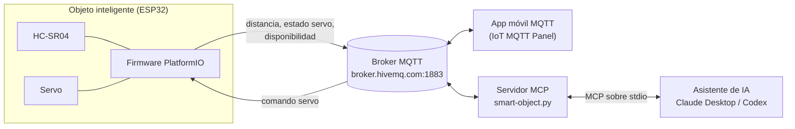

# Práctica MQTT — Integración de un Objeto Inteligente con MQTT y MCP

**Carrera:** Ingeniería de Sistemas

**Docente:** Eduardo Enrique Marin Garcia

**Asignatura:** Internet de las Cosas [SIS-234]

**Semestre:** 2-2026

**Grupo:** 9

**Integrantes:**

- Carlos Eduardo Iriarte Rodriguez
- Isabella Catherine Montes Iñiguez
- Henry Alejandro Rivera Mendez

---

## Índice

1. [Descripción general](#1-descripción-general)
2. [Arquitectura](#2-arquitectura)
3. [Estructura del repositorio](#3-estructura-del-repositorio)
4. [Contrato MQTT](#4-contrato-mqtt)
5. [Firmware del ESP32](#5-firmware-del-esp32)
6. [Servidor MCP](#6-servidor-mcp)
7. [Puesta en marcha](#7-puesta-en-marcha)
8. [Pruebas](#8-pruebas)
9. [Requerimientos de la práctica](#9-requerimientos-de-la-práctica)
10. [Limitaciones conocidas](#10-limitaciones-conocidas)
11. [Solución de problemas](#11-solución-de-problemas)

---

## 1. Descripción general

El proyecto integra un **objeto inteligente** con una **herramienta de IA** usando el protocolo **MQTT** como único canal de comunicación:

- Un **ESP32 DevKit V1** mide distancias con un sensor ultrasónico **HC-SR04** y controla un **servomotor**. Publica sus datos y recibe comandos por MQTT.
- Un **broker MQTT público en la nube** (`broker.hivemq.com`) conecta a todos los clientes. Ningún componente se comunica directamente con el ESP32.
- Un **servidor MCP** (Model Context Protocol) escrito en Python actúa como cliente MQTT y expone tres herramientas a un asistente de IA (Claude Desktop, Codex). Así el asistente puede responder en lenguaje natural:
  - *"¿Cuál es la distancia actual detectada por mi ESP32?"*
  - *"Mueve el servomotor a 90 grados."* / *"…a 180 grados."*
  - *"¿Cuál es el último ángulo reportado por mi ESP32?"*
- Una **aplicación móvil MQTT** (por ejemplo IoT MQTT Panel) puede usar los mismos tópicos para graficar la distancia y enviar comandos. La app no forma parte de este repositorio (ver [sección 9](#9-requerimientos-de-la-práctica)).

## 2. Arquitectura



Decisiones de diseño relevantes:

| Decisión | Motivo |
|---|---|
| El servidor MCP **no consulta al ESP32**, solo guarda los últimos mensajes recibidos | Las herramientas responden al instante y nunca bloquean esperando telemetría futura. |
| Los callbacks MQTT **solo validan y almacenan** | Recibir una distancia jamás dispara un comando al servo; ambas funciones son independientes. |
| Comandos del servo **sin retain** | Un dispositivo que se reconecta no recibe un comando viejo reproducido. |
| Estado, distancia y disponibilidad **retenidos** (en el firmware) | Un cliente nuevo obtiene de inmediato el último valor conocido, aunque pueda ser histórico. |
| El firmware se separa en clases (`WifiManager`, `MqttManager`, `UltrasonicSensor`, `ServoActuator`) sin dependencias cruzadas | Código modular y orientado a objetos; solo `main.cpp` lee la configuración. |

## 3. Estructura del repositorio

```
practica-mqtt/
├── platformio.ini                  # Placa, framework y librerías del firmware
├── include/
│   ├── config.example.h            # Plantilla de configuración (sin credenciales)
│   ├── config.h                    # Tu configuración real (ignorada por git)
│   ├── WifiManager.h               # Conexión Wi-Fi no bloqueante
│   ├── MqttManager.h               # Conexión MQTT, Last Will, suscripción y publicación
│   ├── UltrasonicSensor.h          # Driver del HC-SR04
│   └── ServoActuator.h             # Control del servo y validación de ángulos
├── src/
│   ├── main.cpp                    # Une los módulos: setup() y loop()
│   ├── WifiManager.cpp
│   ├── MqttManager.cpp
│   ├── UltrasonicSensor.cpp
│   └── ServoActuator.cpp
└── server_mcp/
    └── smart-object/
        ├── smart-object.py          # Servidor MCP (stdio)
        ├── smart-object.config.json # Broker, tópicos, umbrales y logging
        ├── requirements.txt         # mcp>=1.12,<2 · paho-mqtt>=2.1,<3
        ├── GUIDE.md                 # Instalación, clientes MCP y plan de pruebas
        └── pyproject.toml, src/     # Andamiaje de uv (no se usa para ejecutar el servidor)
```

## 4. Contrato MQTT

| Parámetro | Valor |
|---|---|
| Broker | `broker.hivemq.com` |
| Puerto | `1883` (TCP plano, sin TLS) |
| Autenticación | Ninguna |

| Tópico | Publica | Se suscribe | Payload |
|---|---|---|---|
| `sis234/grupo9/distancia` | ESP32 | App, servidor MCP | Número en cm con dos decimales, p. ej. `23.45` |
| `sis234/grupo9/servo` | App, servidor MCP | ESP32 | Entero `0`–`180` en texto plano, sin espacios, comillas ni saltos de línea |
| `sis234/grupo9/servo/estado` | ESP32 | App, servidor MCP | Entero `0`–`180` en texto plano |
| `sis234/grupo9/estado` | ESP32 (y broker vía Last Will) | App, servidor MCP | `online` u `offline` |

Calidad de servicio y retención (según `config.example.h`):

| Mensaje | QoS de publicación | Retain |
|---|---|---|
| Distancia | 0 | Sí |
| Estado del servo | 0 | Sí |
| Estado `online` | 0 | Sí |
| Last Will `offline` | 1 | Sí |
| Suscripción al comando | 1 | — |
| Comando del servo (servidor MCP) | 0 | **No** |

> PubSubClient 2.8 solo publica con QoS 0; el QoS configurable aplica a la suscripción y al Last Will.

Limitaciones del contrato: los payloads **no llevan timestamp ni ID de comando**, los tópicos **no identifican dispositivos** (los comparte el grupo) y los mensajes retenidos pueden representar valores antiguos.

## 5. Firmware del ESP32

### 5.1 Hardware

| Elemento | ESP32 |
|---|---|
| HC-SR04 TRIG | GPIO 32 |
| HC-SR04 ECHO | GPIO 35 (a través de un divisor de tensión) |
| Servo, señal | GPIO 19 |
| GND del sensor y del servo | GND común con el ESP32 |

- El HC-SR04 se alimenta con **5 V** y su pin ECHO entrega 5 V, por lo que debe reducirse a ~3,3 V con un divisor (por ejemplo ECHO → 1 kΩ → GPIO → 2 kΩ → GND).
- Alimenta el servo con una fuente adecuada a su corriente y tensión, compartiendo GND con el ESP32.
- Ajusta `SERVO_MIN_US` y `SERVO_MAX_US` según el modelo de servo para no forzar los extremos mecánicos.

### 5.2 Módulos

| Clase | Archivos | Responsabilidad |
|---|---|---|
| `WifiManager` | `WifiManager.h/.cpp` | Conecta en modo estación y reintenta cada 10 s usando `millis()` (no bloquea). Informa por serie cuando cambia el estado. |
| `MqttManager` | `MqttManager.h/.cpp` | Genera el ID de cliente (prefijo + MAC), registra el Last Will `offline`, se suscribe al comando tras **cada** reconexión, publica `online`, entrega comandos por callback y publica distancia y estado del servo. Reintenta cada 5 s. |
| `UltrasonicSensor` | `UltrasonicSensor.h/.cpp` | Genera el pulso de 10 µs en TRIG, mide el eco con `pulseIn` (timeout 30 ms) y calcula `distancia = duración × 0,0343 / 2`. Rechaza lecturas sin eco o fuera de 2–400 cm. |
| `ServoActuator` | `ServoActuator.h/.cpp` | Controla el servo con ESP32Servo a 50 Hz. `parseAngle()` acepta solo 1–3 dígitos sin signo que representen 0–180; `setAngle()` mueve el servo y recuerda el último ángulo. |
| `main.cpp` | `src/main.cpp` | Construye los objetos con los valores de `Config`, conecta los callbacks y ejecuta el ciclo principal. |

Cada clase recibe sus parámetros por constructor y no conoce a las demás ni la configuración global; todo el código está documentado con comentarios Doxygen.

### 5.3 Comportamiento

1. **Arranque:** inicializa sensor y servo (el servo va a **90°**), inicia Wi-Fi y configura MQTT.
2. **Bucle principal:** `wifi.update()` → `mqtt.update()` → `measureAndPublish()`, sin bloqueos largos.
3. **Medición:** cada **5 s** mide la distancia. Si es válida (2–400 cm) y hay MQTT, la publica con dos decimales. Si no hay eco o está fuera de rango, **no publica**. Las lecturas hechas sin MQTT se **descartan** (no se encolan).
4. **Comando de servo:** al llegar un mensaje al tópico `sis234/grupo9/servo`, lo valida; si es un entero 0–180, mueve el servo y publica el ángulo en `servo/estado`. Cualquier otro mensaje se ignora y se anota en el monitor serie.
5. **Reconexión:** si cae Wi-Fi o MQTT, reintenta solo. El servo **conserva el último ángulo** durante las reconexiones; tras reconectar vuelve a suscribirse, publica `online` y reporta el ángulo actual. Si el ESP32 se **reinicia**, el servo vuelve a 90°.
6. **Disponibilidad:** al conectar publica `online` (retenido); si la conexión se pierde de forma inesperada, el broker publica el Last Will `offline` (retenido).

### 5.4 Configuración

Copia `include/config.example.h` a `include/config.h` (excluido por `.gitignore`) y edita:

| Grupo | Constantes principales |
|---|---|
| Wi-Fi | `WIFI_SSID`, `WIFI_PASSWORD` |
| Broker | `MQTT_HOST`, `MQTT_PORT`, `MQTT_USER`, `MQTT_PASSWORD`, `MQTT_CLIENT_PREFIX` |
| Tópicos | `TOPIC_DISTANCE`, `TOPIC_SERVO_CMD`, `TOPIC_SERVO_STATE`, `TOPIC_STATUS` |
| MQTT | retain por tipo de mensaje, QoS de suscripción y Last Will, keep-alive (15 s), timeout de socket (2 s) |
| Tiempos | `WIFI_RETRY_MS` (10 s), `MQTT_RETRY_MS` (5 s), `DISTANCE_PUBLISH_INTERVAL_MS` (5 s) |
| Sensor | pines, `ECHO_TIMEOUT_US`, `SOUND_CM_PER_US`, `DISTANCE_MIN_CM`, `DISTANCE_MAX_CM` |
| Servo | `SERVO_PIN`, frecuencia, `SERVO_MIN_US`, `SERVO_MAX_US`, `SERVO_INITIAL_ANGLE` |

Las credenciales nunca se suben al repositorio. Usa tópicos con un prefijo único del grupo: el broker es público.

### 5.5 Compilar y cargar

Requiere [PlatformIO](https://platformio.org/). Placa `esp32doit-devkit-v1`, framework Arduino, librerías **PubSubClient 2.8** y **ESP32Servo 0.13.0**.

```sh
pio run                    # compilar
pio run --target upload    # cargar al ESP32
pio device monitor         # monitor serie a 115200 baudios
```

## 6. Servidor MCP

`server_mcp/smart-object/smart-object.py` es un servidor MCP con transporte **stdio**, hecho con el SDK oficial (`FastMCP`) y `paho-mqtt` 2.x (API de callbacks versión 2). Requiere **Python 3.11 o superior**.

> Se fija `mcp>=1.12,<2` porque MCP 2.x renombró `FastMCP` y eliminó el módulo `mcp.server.fastmcp`.

### 6.1 Herramientas expuestas

| Herramienta | Parámetros | Propósito |
|---|---|---|
| `get_distance` | — | Devuelve la última distancia válida (cm), la hora UTC de **recepción**, su edad en segundos, si está desactualizada (`stale`), si llegó como mensaje retenido, el estado de la conexión MQTT y la disponibilidad del dispositivo. |
| `set_servo_angle` | `angle`: entero 0–180 | Publica el ángulo como texto en `sis234/grupo9/servo` con QoS 0 y retain desactivado. No espera movimiento ni confirmación. |
| `get_servo_status` | — | Devuelve el último ángulo **reportado** por el firmware en `servo/estado`, su edad, si llegó retenido, el estado MQTT y la disponibilidad. |

Reglas importantes de cada herramienta:

- **`get_distance`**
  - Solo acepta números finitos entre 2 y 400 cm; los payloads malformados, vacíos, `nan`, `inf`, fuera de rango o con UTF-8 inválido se ignoran y **no sobrescriben** el último valor válido.
  - Marca `stale: true` si la edad supera `stale_after_seconds` (15 s por defecto).
  - Si el valor llegó retenido, aclara que su hora de medición original es desconocida aunque se haya recibido hace un instante.
  - Sin datos devuelve `available: false` con un mensaje explicativo.
  - La disponibilidad `online` guardada **no se considera válida** si el servidor está desconectado: se reporta como `unknown` (el dato queda en `last_reported_availability`).
- **`set_servo_angle`**
  - Rechaza booleanos, cadenas, fraccionarios (`90.5`) y valores fuera de 0–180 (`-1`, `181`) con un error claro. La validación del tipo es estricta, por lo que `true` y `"90"` se rechazan como errores de validación de la herramienta.
  - Si MQTT está desconectado o la publicación falla, devuelve `success: false`.
  - Un `success: true` significa solo que el cliente MQTT local aceptó el mensaje; **no es un acuse del ESP32** ni prueba que el servo se movió. Tampoco actualiza de forma optimista el estado reportado.
- **`get_servo_status`**
  - Solo acepta enteros 0–180 en texto plano.
  - El valor es el último ángulo *comandado* según el firmware, no una posición medida.
  - La edad por sí sola no indica falla: el firmware solo reporta tras un comando o una reconexión.
  - El protocolo no tiene IDs de comando, por lo que el estado no confirma que un comando específico se haya ejecutado.

### 6.2 Funcionamiento interno

| Aspecto | Implementación |
|---|---|
| Conexión | `connect_async` + `loop_start`: el hilo de red de paho corre en segundo plano. |
| Reintentos | Reintento inicial y reconexión automática con backoff exponencial acotado (`reconnect_min_delay` → `reconnect_max_delay`). |
| Suscripciones | Se renuevan en **cada** conexión exitosa: distancia, estado del servo y disponibilidad (el tópico de comando no se suscribe). |
| Disponibilidad | El servidor MCP sigue operativo aunque MQTT esté caído. |
| ID de cliente | `client_id_prefix` + UUID por proceso. |
| Estado compartido | Protegido con `threading.Lock`; las herramientas leen *snapshots* consistentes y el candado nunca se mantiene durante operaciones de red. |
| Tiempo | Marcas de tiempo UTC con zona horaria para mostrar; reloj monotónico para calcular edades. |
| Logging | Módulo `logging` hacia **stderr**; stdout queda reservado al protocolo MCP. |
| Ciclo de vida | El *lifespan* de FastMCP inicia el servicio MQTT al arrancar y lo detiene limpiamente al cerrar. |

### 6.3 Configuración (`smart-object.config.json`)

| Clave | Valor por defecto | Descripción |
|---|---|---|
| `mqtt.host` / `mqtt.port` | `broker.hivemq.com` / `1883` | Broker |
| `mqtt.client_id_prefix` | `smart-object-mcp-` | Prefijo del ID de cliente |
| `mqtt.keepalive` | `30` | Segundos |
| `mqtt.reconnect_min_delay` / `reconnect_max_delay` | `1` / `60` | Backoff de reconexión (s) |
| `topics.distance`, `servo_command`, `servo_state`, `availability` | Los 4 tópicos del contrato | Deben ser distintos y sin comodines |
| `distance.stale_after_seconds` | `15` | Umbral de datos desactualizados |
| `distance.min_cm` / `max_cm` | `2` / `400` | Rango válido |
| `logging.level` | `INFO` | `DEBUG`, `INFO`, `WARNING`, `ERROR`, `CRITICAL` |

La ruta por defecto es la del archivo junto a `smart-object.py`, así que funciona desde cualquier directorio. Se puede indicar otra con `--config RUTA` o con la variable de entorno `SMART_OBJECT_CONFIG` (el argumento tiene prioridad). Si la configuración es inválida, el servidor muestra un error accionable por stderr y termina con código 2.

## 7. Puesta en marcha

### 7.1 Firmware

Ver [5.5](#55-compilar-y-cargar). Primero completa `include/config.h`.

### 7.2 Servidor MCP

```powershell
cd server_mcp\smart-object
python -m venv .venv
.\.venv\Scripts\python.exe -m pip install -r requirements.txt
.\.venv\Scripts\python.exe smart-object.py
```

(En macOS/Linux: `./.venv/bin/python`.) Al ejecutarlo a mano, el proceso espera mensajes MCP por stdin y los logs salen por stderr.

Para inspeccionarlo con **MCP Inspector** (requiere Node.js):

```powershell
npx @modelcontextprotocol/inspector "<ruta absoluta>\.venv\Scripts\python.exe" "<ruta absoluta>\smart-object.py"
```

### 7.3 Registro en clientes MCP

Usa siempre **rutas absolutas**, incluido el Python del entorno virtual.

**Claude Desktop** — *Configuración → Desarrollador → Edit Config* (`claude_desktop_config.json`; en la versión de Microsoft Store el archivo está bajo `%LOCALAPPDATA%\Packages\Claude_*\LocalCache\Roaming\Claude\`):

```json
{
  "mcpServers": {
    "smart-object": {
      "command": "C:\\ruta\\a\\server_mcp\\smart-object\\.venv\\Scripts\\python.exe",
      "args": ["C:\\ruta\\a\\server_mcp\\smart-object\\smart-object.py"]
    }
  }
}
```

Reinicia Claude Desktop por completo; el servidor debe aparecer como activo en Desarrollador.

**Codex**:

```powershell
codex mcp add smart-object -- "C:\ruta\a\.venv\Scripts\python.exe" "C:\ruta\a\smart-object.py"
```

o en `~/.codex/config.toml`:

```toml
[mcp_servers.smart-object]
command = 'C:\ruta\a\.venv\Scripts\python.exe'
args = ['C:\ruta\a\smart-object.py']
startup_timeout_sec = 20
```

Detalles y capturas de logs en [`server_mcp/smart-object/GUIDE.md`](server_mcp/smart-object/GUIDE.md).

## 8. Pruebas

El plan completo está en la [guía](server_mcp/smart-object/GUIDE.md#6-test-procedure). Resumen de lo que se verifica:

| Prueba | Resultado esperado |
|---|---|
| `get_distance` antes de recibir datos | `available: false` y un mensaje explicativo |
| Distancia válida | Valor, edad pequeña, `stale: false` |
| Payloads `abc`, `nan`, `inf`, `1.99`, `400.01`, vacío | Se ignoran y se conserva el último valor válido |
| Esperar más del umbral | `stale: true` |
| Mensaje retenido | `retained: true` y aviso de que la hora de medición es desconocida |
| Comandos 90° y 180° | Aparecen en `servo` como `90` y `180`, sin retain |
| `-1`, `181`, `90.5`, `true` | Rechazados; nada se publica |
| `get_servo_status` antes/después del estado | `available: false` / ángulo reportado |
| Broker inalcanzable | Las herramientas responden; `set_servo_angle` devuelve error de MQTT desconectado |
| Caída y recuperación del broker | Reconexión automática y suscripciones renovadas |
| Medición y servo a la vez | Las distancias se siguen actualizando; recibir distancia no genera comandos |

Con Mosquitto puedes observar el sistema real (solo lectura) o simularlo:

```sh
# Observar todo el tráfico real del grupo
mosquitto_sub -h broker.hivemq.com -p 1883 -v -t "sis234/grupo9/#"

# Enviar un comando real al servo (¡moverá el servo físico!)
mosquitto_pub -h broker.hivemq.com -p 1883 -t "sis234/grupo9/servo" -m "90"
```

> **Simulación:** inyectar valores falsos en `sis234/grupo9/...` afecta a todos los clientes conectados (compañeros, apps, el ESP32 real). Para simular, copia `smart-object.config.json`, cambia los cuatro tópicos a un prefijo alterno (por ejemplo `sis234/grupo9-test-<nombre>`) y publica ahí. Lo publicado manualmente es **simulado**, no telemetría real del ESP32.

Los resultados de las pruebas automáticas de integración del servidor (cliente MCP real sobre stdio contra HiveMQ, con tópicos alternos) fueron correctos para validación de payloads, comandos y operación sin MQTT. La reconexión tras la caída de un broker en funcionamiento y las pruebas con el ESP32 físico deben verificarse en la demostración.

## 9. Requerimientos de la práctica

| Requerimiento | Estado | Dónde |
|---|---|---|
| RF1 Medir distancia | Implementado | `UltrasonicSensor` |
| RF2 Publicar distancia periódicamente | Implementado (cada 5 s) | `main.cpp`, `MqttManager::publishDistance` |
| RF3 Suscripción a comandos y control del actuador (1 servo) | Implementado | `MqttManager`, `ServoActuator`, `handleCommand` |
| RF4 Visualización gráfica en app móvil | **No incluida en el repositorio**; la app (p. ej. IoT MQTT Panel) usa los tópicos del contrato. Falta añadir la exportación del panel si la app lo permite. | — |
| RF5 Comandos desde la app | Mismo caso que RF4: publicar texto `0`–`180` en `sis234/grupo9/servo` | — |
| RF6 IA con lenguaje natural | Implementado mediante el servidor MCP | `smart-object.py` |

Requerimientos no funcionales (sección 3.2 del enunciado). Solo se declaran los valores que se derivan del código; el resto debe **medirse y completarse** antes de la demo:

| Atributo | Valor |
|---|---|
| Reconexión Wi-Fi y MQTT automática | Sí: Wi-Fi cada 10 s, MQTT cada 5 s, sin intervención manual |
| Frecuencia de publicación | 1 lectura cada 5 s (0,2 lecturas/s), configurable con `DISTANCE_PUBLISH_INTERVAL_MS`. Es inferior a la referencia de ≥ 2 lecturas/s del enunciado; ajusta el intervalo si quieres cumplirla. |
| Rango de trabajo del sensor | 2–400 cm |
| Estabilidad (≥ 10 min continuos) | *Por medir* |
| Exactitud (± cm frente a cinta métrica) | *Por medir* |
| Tiempo de respuesta app → broker → servo | *Por medir* |

Las credenciales se mantienen fuera del repositorio mediante `include/config.h` en `.gitignore`, acompañado de `config.example.h`.

## 10. Limitaciones conocidas

- Los payloads de distancia **no tienen timestamp**: las horas reportadas por el servidor MCP son de **recepción**, no de medición.
- El estado del servo es el ángulo *comandado* por el firmware: **no hay sensor de posición** ni IDs de comando. Un comando publicado con éxito no prueba que el servo se haya movido.
- Los mensajes retenidos pueden ser antiguos. Además, el broker solo marca `retained` en los mensajes entregados al momento de suscribirse; uno retenido que se publica mientras el servidor ya está conectado llega con `retained: false`.
- Los tópicos son **compartidos** por el grupo y **no identifican dispositivos**.
- El broker es público y sin autenticación ni TLS: cualquiera puede leer o publicar en los tópicos.
- La conexión MQTT del firmware puede bloquear brevemente, por lo que la cadencia de medición no es de tiempo real estricto.
- El servidor MCP usa por defecto los tópicos **reales**: un comando enviado desde el asistente mueve el servo físico.

## 11. Solución de problemas

| Síntoma | Qué revisar |
|---|---|
| El ESP32 no publica | Monitor serie: estado de Wi-Fi/MQTT y mensajes `Sin medición válida`. Revisa el cableado y el divisor del ECHO. |
| El servo no responde | Que el payload sea solo dígitos 0–180 y que el tópico sea `sis234/grupo9/servo`. El monitor serie muestra `Comando ignorado`. |
| `No module named 'mcp.server.fastmcp'` | Se instaló MCP 2.x; reinstala con `pip install -r requirements.txt`. |
| El servidor no aparece en Claude Desktop | Rutas absolutas, sintaxis JSON, reinicio completo de la aplicación y los logs `mcp-server-smart-object.log`. |
| Las herramientas indican `mqtt_connected: false` | Conexión a internet y alcance de `broker.hivemq.com:1883`. HiveMQ puede tardar un par de segundos en conectar al inicio. |
| `get_distance` devuelve `stale: true` | No llegaron lecturas válidas recientemente (ESP32 apagado, sin eco o sin conexión). |
| Error de configuración al iniciar el servidor | Lee el mensaje por stderr: indica el archivo y el campo inválido. |
